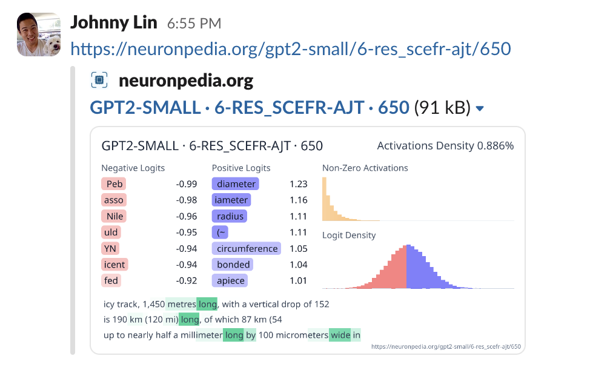

# Feature Dashboards

A **feature dashboard** shows everything that we know about one feature. It has the feature's top activations, its logits, its explanations, and tools to test and steer it.

Each feature is at the URL `neuronpedia.org/[MODEL_ID]/[SOURCE_ID]/[INDEX]`.

For this page, we use feature `10956` in the source `20-gemmascope-res-16k` for `gemma-2-2b`:
[`neuronpedia.org/gemma-2-2b/20-gemmascope-res-16k/10956`](https://www.neuronpedia.org/gemma-2-2b/20-gemmascope-res-16k/10956)

### Example - Feature Dashboard

The dashboard has these parts:

- **Top bar** - Select a model, a source, and an index, then click **Go**. Click **Prev** and **Next** to go to the next index. Click the bookmark icon to save the feature.
- **Explanations** (top left) - Text labels for the feature, with the method and the AI model that made each one. See [Auto-Interp](./auto-interp).
- **New Auto-Interp** - Make a new explanation. Select a method and an AI model, then click **Generate**.
- **Interpretable Score** - Test how interpretable the feature is. See [Auto-Interp](./auto-interp#interpretable-score).
- **Top Features by Cosine Similarity** - Features with the most similar decoder vectors. Some sources also compare with a different source, for example the same layer of a different model.
- **Negative and Positive Logits** - The output tokens that the feature makes less likely (red) and more likely (green).
- **Activations Density** - How often the feature fires, and a histogram of its activation values.
- **Top Activations** - Text where the feature fires the most. Green highlights show the activation on each token. Select **Stacked**, **Snippet**, or **Full** to change the view.
- **Embeds** - Settings and code to [embed](./embeds) this feature.
- **Lists** and **Comments** - [Add the feature to a list](./lists), or discuss it.

Hover over the (?) icons to learn what each part shows.

### Example - Test Activations

Type your own text in the **Test activation with custom text** box, then click **Test**. Neuronpedia runs your text through the model and shows where the feature fires. Use this to test your ideas about a feature.

This needs a source with inference enabled. See [Available Resources](../getting-started/find-resources#available-resources).

### Example - Steer

Click **Steer** next to the test box to open the [steering](../steering) tool with this feature.

### Example - JSON API

You can get the data for a feature as JSON. Add `/api/feature` after `neuronpedia.org` in the URL.

Feature: [`https://www.neuronpedia.org/gemma-2-2b/20-gemmascope-res-16k/10956`](https://www.neuronpedia.org/gemma-2-2b/20-gemmascope-res-16k/10956)

JSON: [`https://www.neuronpedia.org/api/feature/gemma-2-2b/20-gemmascope-res-16k/10956`](https://www.neuronpedia.org/api/feature/gemma-2-2b/20-gemmascope-res-16k/10956)

This is a `GET` request, so you can open it in your browser. See the [API](../api-and-data/api) for more.

### Example - Share

When you share a link to a feature in a place like Slack or X, a preview image shows automatically.

### Vector Dashboards

Custom steering vectors have the same kind of dashboard. It shows the vector's layer, hook, default steering strength, and raw values. See [Custom Vectors](../steering#custom-vectors).

